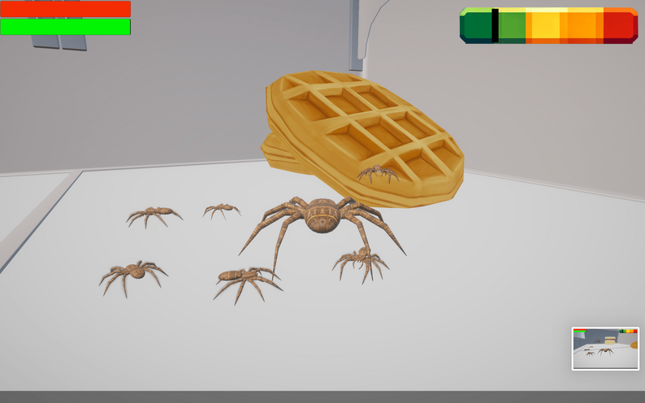
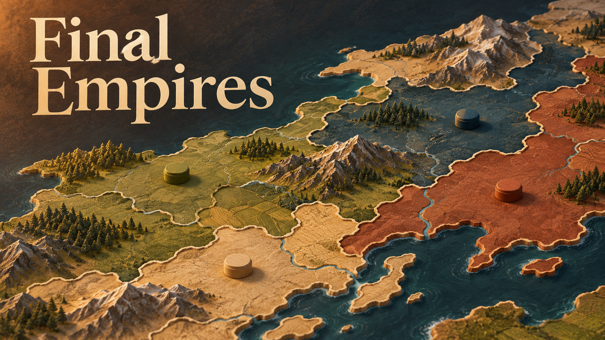

# Martin Garas

I’m Martin. I make games with **MUT Studios**.

[Play something](https://mut-studios.itch.io/) / [Watch the channel](https://www.youtube.com/@MUT-Studios) / [Read a devlog](https://github.com/UnspeakableTNT/Final-Empires)

<!-- BEGIN AUTO:profile-projects sha256=aa45da86210b3d5a605293ace2181f21b1711f80bd19bcb09fb3d1033f52bc32 -->
## Games you can play

<table>
<tr>
<td width="50%" valign="top">
<h3><a href="docs/projects/spider-control.md">Spider Control</a></h3>

Spider Control gameplay.

Steal food, dodge the kids, and watch out for the cat. You’re the spider.

<a href="https://mut-studios.itch.io/spider-control"><strong>Play</strong></a> / <a href="docs/projects/spider-control.md">More about the game</a>

</td>
<td width="50%" valign="top">
<h3><a href="docs/projects/final-empires.md">Final Empires</a></h3>

AI-generated illustration.

Start with one nation. Try to take the map. Then survive the Final Empire.

<a href="https://finalempires.com"><strong>Play</strong></a> / <a href="docs/projects/final-empires.md">More about the game</a>

</td>
</tr>
</table>

## Still working on

### [??? 👀](docs/projects/surprise.md)

- **[AKHRON](docs/projects/akhron.md)**: A game I’m working on with MUT Studios. Still in development.

## Smaller projects and experiments

- **[Voice Website](docs/projects/voice-website.md)**: A small experiment with voice navigation.
- **[recyclingDetector](docs/projects/recycling-detector.md)**: An experiment in telling trash and recycling apart.
- **[Qwen Voice Studio](docs/projects/qwen-voice-studio.md)**: A local voice tool I’m preparing for a possible public release.
<!-- END AUTO:profile-projects -->

## Watch a little

- [Spider Control trailer](https://www.youtube.com/watch?v=OThtFKlo3Xw) / 1:10
- [Drifted Beyond gameplay](https://www.youtube.com/watch?v=DTgNdEZ3vew) / 1:02
- [Dark Tales walkthrough](https://www.youtube.com/watch?v=QLADvfRPv34) / 13:55

## Always looking for artists

I’m always looking for artists to make the art and design better. If that’s you, I’d love to see your work.

**We don’t use AI in the production of our games, or for their art and style.**

A few illustrations here on GitHub are AI-generated. There’s a small note under each one.

<!-- BEGIN AUTO:latest-updates sha256=272a214979c9751d118415a27406bee296c007299c23b8a6c51bf3ab2a69e836 -->
## Latest updates

- 2026-11-06: [A little AKHRON update](docs/updates/2026-11-06-akhron-november-update.md)
<!-- END AUTO:latest-updates -->
