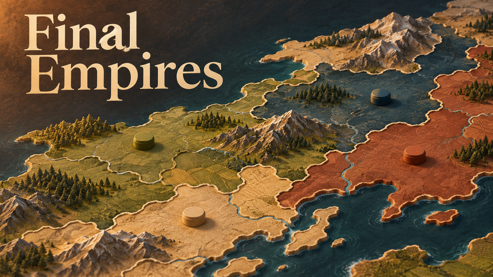

<!-- BEGIN AUTO:project-final-empires sha256=974234f34171b7e0243ec919d5fd0e7e6455fa9aa5291a0a5dbe4f6a03f7befc -->
# Final Empires

Start with one nation. Try to take the map. Then survive the Final Empire.

[Open project](https://finalempires.com)

AI-generated illustration.

## Build a nation, then try to keep it

Final Empires is a browser-based real-time multiplayer strategy game. Start with a nation, build your economy, and expand across the map.

The game has 195 real-world nations, extra generated nations for larger maps, and bots with difficulty levels from Easy to Impossible. Cities, factories, troop camps and ports support the war effort. Jets, warships, submarines and missiles change what you can do.

Conquering too much brings infamy and sanctions. Then the Final Empire arrives and turns the late game into a survival fight.

## The stories behind the bugs

The GitHub repository is for development notes. The game source stays private.

One write-up follows a final-boss bug that looked like a balance problem but turned out to be an identity mix-up. It includes the wrong turns as well as the fix.

## Links

- [Play Final Empires](https://finalempires.com)
- [Read the final-boss bug story](https://github.com/UnspeakableTNT/Final-Empires/blob/main/reports/final-empire-bug-case-study.md)
<!-- END AUTO:project-final-empires -->

## November 11: story mode work

I'm working through the controls, unit behavior, saving and sound. The map needs less text over it and the people on it need to do their jobs. Marketplace tools for future maps and story worlds are also on the list.

[Read the update](../updates/2026-11-11-final-empires-update.md). The update is still in development, so don't read this as a release announcement.
