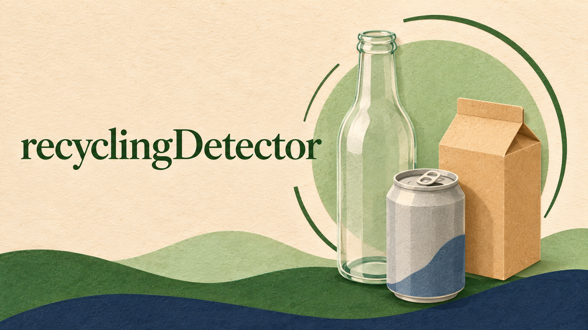

<!-- BEGIN AUTO:project-recycling-detector sha256=c91be29019445786ec6cfd0228a93854963538238102be332db78142b91d88cb -->
# recyclingDetector

An experiment in telling trash and recycling apart.

[Open project](https://github.com/UnspeakableTNT/recyclingDetector)

AI-generated illustration.

## An early experiment

This project explores telling trash and recycling apart. It is an experiment rather than a verified recycling guide.

Training data, accuracy, and real-world results have not been checked for these notes. Follow your local recycling guidance when deciding what belongs in a bin.

## Links

- [Look at the code](https://github.com/UnspeakableTNT/recyclingDetector)
<!-- END AUTO:project-recycling-detector -->
