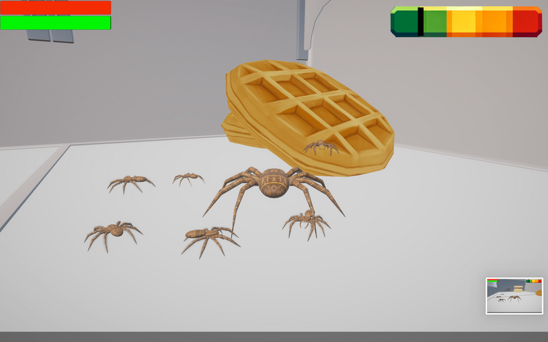

<!-- BEGIN AUTO:project-spider-control sha256=9bf0648597c16199495e6683bd549dbc0d12efbc8688e5b3a9c95a3cba7b20e3 -->
# Spider Control

Steal food, dodge the kids, and watch out for the cat. You’re the spider.

[Open project](https://mut-studios.itch.io/spider-control)

Spider Control gameplay.

## A house full of trouble

You are the spider. Find food and keep out of sight while the kids and the cat make getting around difficult.

The 1.0.8 update added skins, achievements, infinite rooms, and a larger UI. Egyptian Arabic voice lines can be turned on in settings.

## Pick a version

The itch.io page has browser play and desktop downloads for Windows, macOS, and Linux. The browser version does not save your progress.

Use the current game page for downloads. These notes are not a new compatibility test of every build.

## Watch

- [Spider Control Trailer](https://www.youtube.com/watch?v=OThtFKlo3Xw)

## Links

- [Play Spider Control](https://mut-studios.itch.io/spider-control)
- [What changed in 1.0.8](https://mut-studios.itch.io/spider-control/devlog/956514/biggest-update-yet)
<!-- END AUTO:project-spider-control -->
